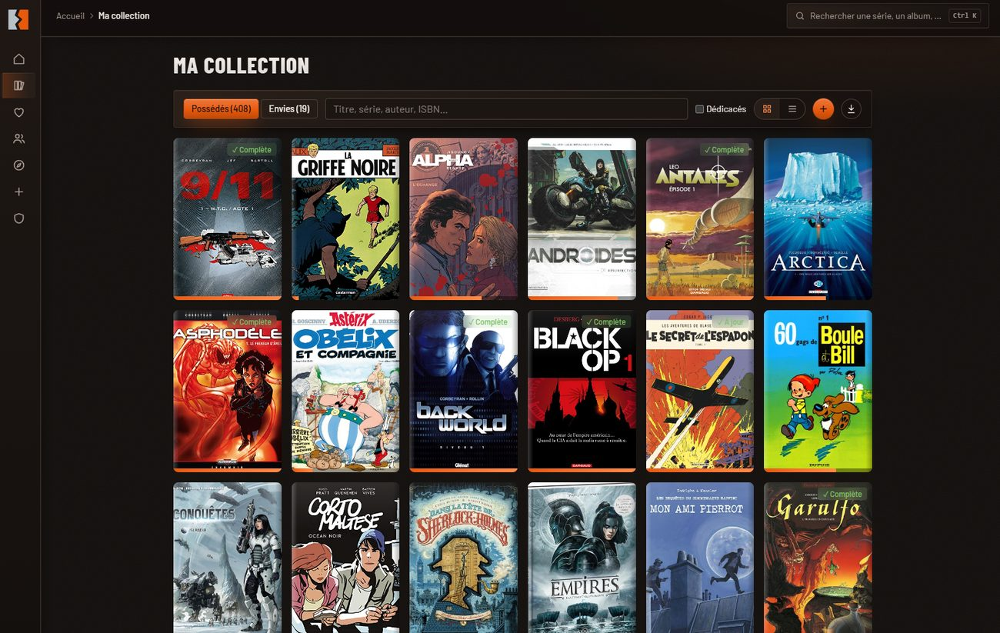
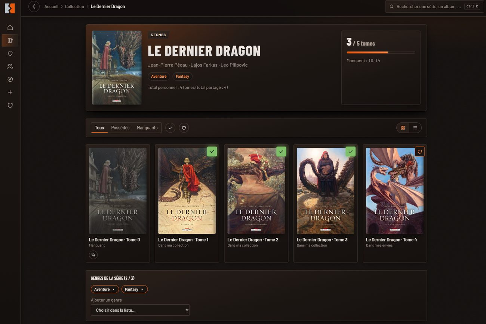
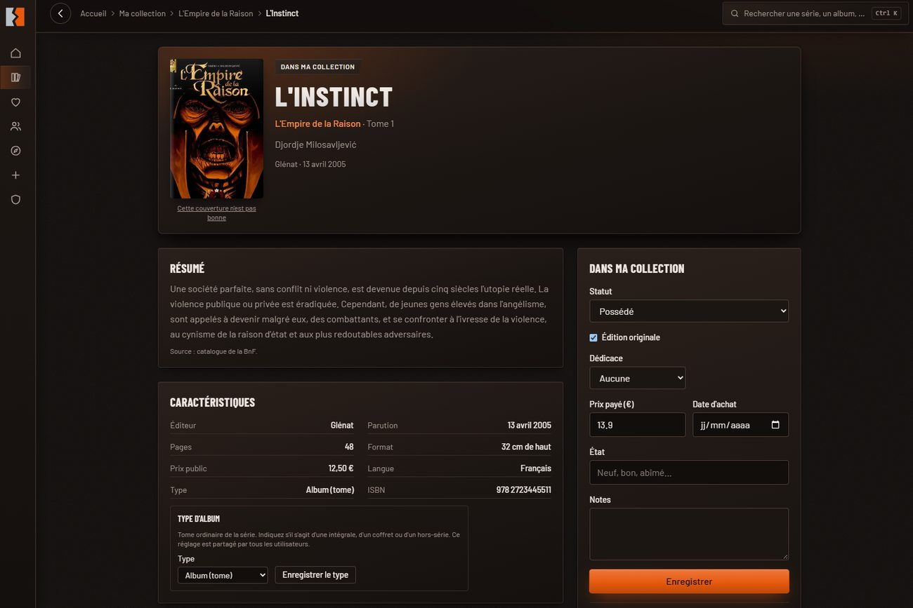
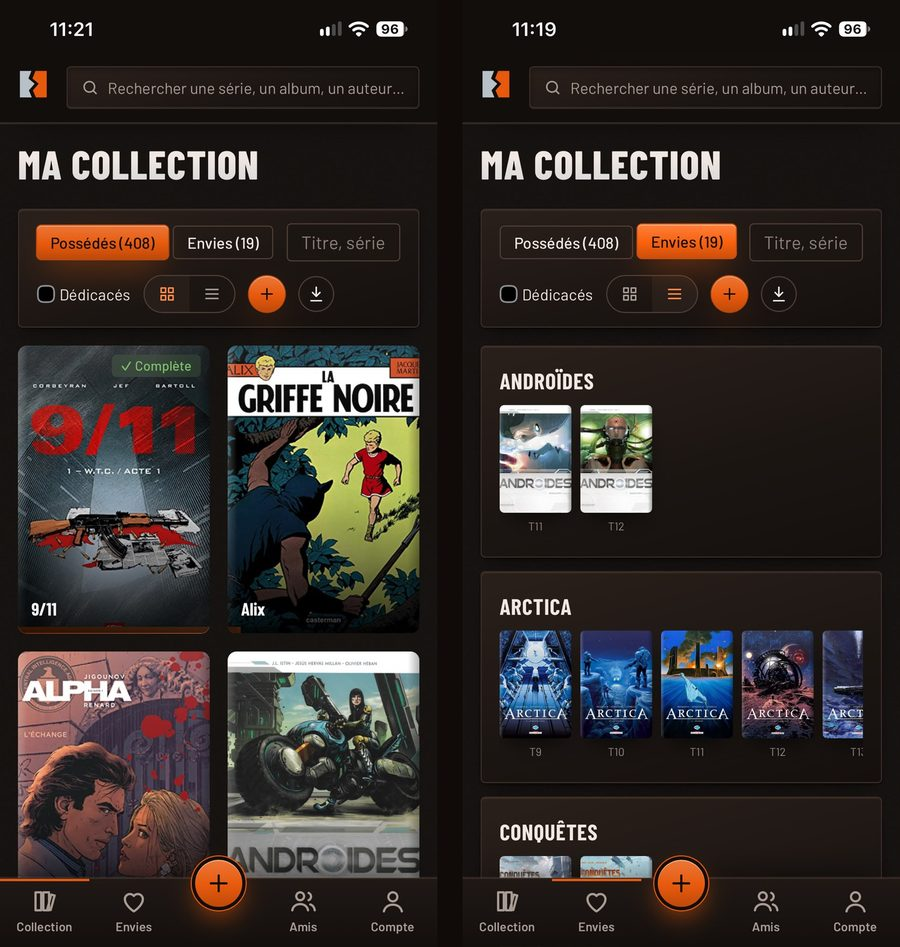

# BDbyNico

Application web et mobile gratuite pour gérer sa collection de bandes dessinées : séries, tomes
possédés, tomes manquants, envies, et partage avec ses amis.

**👉 [Ouvrir l'application](https://magiccode666.github.io/BDbyNico/)** : elle s'utilise dans le
navigateur et s'installe sur l'écran d'accueil du téléphone (PWA).



## Fonctions

- **Ajouter une BD** en scannant son code-barres avec le téléphone, ou en saisissant son ISBN.
  Le titre, les auteurs, le résumé et la couverture viennent du catalogue de la BnF.
- **Suivre ses séries** : tomes possédés, tomes manquants, tomes à ignorer, séries complètes ou à
  jour. Les intégrales, coffrets et hors-séries sont gérés à part des tomes.
- **Collection et envies** : prix payé, état, notes, dédicace, édition originale.
- **Catalogue partagé** : un album ajouté par un utilisateur profite à tous. Les corrections sont
  journalisées et annulables par les modérateurs.
- **Explorer** par genre, et recherche globale (`Ctrl + K`).
- **Partager** sa collection en lecture seule par un lien, et suivre celle de ses amis.
- **Importer et exporter** sa collection au format CSV.
- Thèmes sombre et clair, utilisables sur ordinateur comme sur mobile.

<p>
  
  
</p>



## Vie privée

Chaque utilisateur a sa propre collection, privée par défaut. L'isolation entre les comptes est
garantie par les règles d'accès de la base (RLS), vérifiées par un script de contrôle. Le compte et
toutes ses données peuvent être supprimés depuis le profil.

## Technologies

React, TypeScript, Vite, Tailwind CSS, PWA, et Supabase (base PostgreSQL, authentification). Le site
est publié avec GitHub Pages.

## Lancer le projet en local

```
npm install
cp .env.example .env.local   # puis renseigner l'adresse et la clé publique de votre projet Supabase
npm run dev
```

Le schéma de la base est dans `supabase/migrations` (`npx supabase db push` pour l'appliquer à votre
projet). `npm test` rejoue toutes les migrations sur une base embarquée, sans aucun secret.

## Contribuer

Voir [CONTRIBUTING.md](CONTRIBUTING.md).

## Données et couvertures

Les informations des albums viennent du catalogue de la Bibliothèque nationale de France. Les
couvertures sont affichées depuis leur source, sans être copiées : elles restent la propriété de
leurs éditeurs, comme les textes. Un contenu peut être retiré sur simple demande (voir les mentions
légales de l'application).

## Licence

[MIT](LICENSE)
